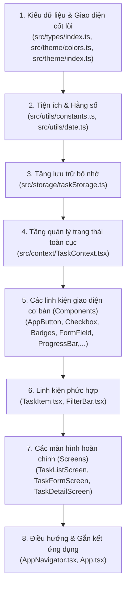

# TÀI LIỆU GIẢI THÍCH TOÀN BỘ MÃ NGUỒN ỨNG DỤNG QUẢN LÝ KẾ HOẠCH CÁ NHÂN (PLANNER APP)

> **Chào bạn!** Nếu bạn là một người mới bắt đầu bước chân vào thế giới lập trình di động với React Native và TypeScript, tài liệu này được biên soạn dành riêng cho bạn. Chúng ta sẽ cùng nhau "mổ xẻ" từng ngóc ngách của ứng dụng bằng ngôn ngữ đời thường, hình tượng hóa những khái niệm trừu tượng thành những ví dụ gần gũi trong cuộc sống hàng ngày.

---

## 1. TỔNG QUAN ỨNG DỤNG (APP OVERVIEW)

### 1.1. Ứng dụng làm được những gì?
Đây là ứng dụng **Quản lý kế hoạch cá nhân** (Personal Task Planner) hoạt động mượt mà trên hệ điều hành Android và iOS:
- **Xem danh sách công việc**: Hiển thị các công việc cần làm dưới dạng từng thẻ (Card) trực quan. Công việc đã xong sẽ tự gạch ngang tên và mờ đi.
- **Thanh tiến độ trực quan**: Tự động tính toán phần trăm hoàn thành tổng thể (ví dụ: `Đã hoàn thành 2/7 công việc (29%)`) với thanh tiến độ đổi màu sắc nét.
- **Thêm công việc mới**: Nhập tên việc (tối đa 50 ký tự), ghi chú, chọn danh mục (lưới 2x2: Học tập, Công việc, Sức khỏe, Cá nhân), mức ưu tiên (Cao, Trung bình, Thấp có chấm màu tương ứng) và hạn chót (`dd/mm/yyyy`). Form có kiểm tra lỗi thông minh (chặn ngày quá khứ, chặn ngày không có trên lịch như 31/02).
- **Chỉnh sửa công việc**: Thay đổi nội dung, điều chỉnh ngày hạn hoặc danh mục của công việc hiện có.
- **Đánh dấu hoàn thành**: Bấm vào ô Checkbox tự thiết kế để hoàn thành hoặc mở lại công việc.
- **Xem chi tiết công việc**: Bấm vào thẻ để chuyển sang màn hình chi tiết, hiển thị cảnh báo hạn thông minh: `Còn x ngày`, `Hạn hôm nay` hoặc nhãn đỏ `Quá hạn x ngày`.
- **Xóa công việc an toàn**: Giữ lâu (Long press) vào công việc ở danh sách hoặc bấm nút Xóa ở màn hình chi tiết đều hiện hộp thoại cảnh báo `Alert` xác nhận trước khi xóa, chống bấm nhầm.
- **Bộ lọc đa năng**: Lọc theo 4 tab: *Tất cả*, *Chưa xong*, *Đã xong*, *Quá hạn* kèm số lượng đếm trên từng tab.
- **Tìm kiếm thông minh**: Gõ từ khóa tìm kiếm theo tên việc, tự động bỏ qua chữ hoa/chữ thường.
- **Sắp xếp linh hoạt**: Đổi chế độ sắp xếp bằng 1 chạm giữa *Hạn gần nhất* và *Ưu tiên Cao → Thấp*.
- **Lưu trữ vĩnh viễn (Offline Persistence)**: Dữ liệu tự động lưu vào bộ nhớ máy qua `AsyncStorage`, tắt app hoặc khởi động lại máy dữ liệu vẫn còn nguyên vẹn.

### 1.2. Công nghệ sử dụng và lý do lựa chọn

| Công nghệ / Thư viện | Vai trò | Tại sao lại dùng? (Giải thích đời thường) |
| :--- | :--- | :--- |
| **React Native (CLI)** | Khung nền tảng (Framework) | Viết code bằng JavaScript/TypeScript một lần nhưng ứng dụng chạy được trên cả Android lẫn iPhone, không cần viết 2 ngôn ngữ Java và Swift riêng biệt. Giống như một người phiên dịch nói được cả tiếng Anh và tiếng Pháp. |
| **TypeScript (TSX/TS)** | Ngôn ngữ lập trình | Giúp đặt "khuôn mẫu" cho dữ liệu. Nếu bạn định gửi một con số mà lỡ tay gửi một chữ cái, TypeScript sẽ báo lỗi ngay lúc gõ phím chứ không đợi đến khi app chạy bị sập (crash). |
| **React Navigation (Native Stack)** | Điều hướng màn hình | Đóng vai trò như "người chỉ đường", quản lý việc chuyển đổi giữa màn hình Danh sách, màn hình Thêm/Sửa và màn hình Chi tiết bằng hiệu ứng trượt mượt mà. |
| **AsyncStorage** | Bộ nhớ lưu trữ dữ liệu | Giống như chiếc tủ lạnh hay cuốn sổ tay nhỏ trong điện thoại, giúp lưu lại danh sách công việc khi bạn tắt máy và lấy ra khi mở lại app. |
| **React Native Safe Area Context** | Xử lý vùng hiển thị an toàn | Giúp giao diện không bị camera "đục lỗ" hay "tai thỏ" đè lên nội dung hiển thị ở cạnh trên và dưới màn hình. |

> [!NOTE]
> **Quy chuẩn đặc biệt**: Toàn bộ các thành phần như Checkbox, Thanh tiến độ (Progress Bar), Nút bấm (Button), Hộp chọn (ChipSelector) đều được **tự lập trình thủ công (Custom Components)** từ các khối gạch cơ bản của React Native (`View`, `Text`, `Pressable`, `TextInput`), tuyệt đối không dựa dẫm vào các thư viện giao diện có sẵn.

### 1.3. Cấu trúc thư mục dạng cây (Folder Tree)

```text
B23DCCC073_GiuaKy_App/
├── App.tsx                     # Điểm khởi đầu của ứng dụng, bọc Context và Navigation
├── index.js                    # Đăng ký app gốc với hệ điều hành React Native
├── package.json                # Danh sách khai báo thư viện và script chạy
├── tsconfig.json               # Cấu hình kiểm tra kiểu dữ liệu TypeScript
├── android/                    # Mã nguồn gốc của dự án Android
│   └── app/src/main/java/.../MainActivity.kt  # Cấu hình Activity nền tảng
└── src/                        # Toàn bộ mã nguồn chính của ứng dụng
    ├── types/
    │   └── index.ts            # Nơi định nghĩa các "khuôn mẫu" dữ liệu (Interface/Type)
    ├── theme/
    │   ├── colors.ts           # Bảng màu chủ đạo toàn app (Theme Vàng Kem ấm áp)
    │   └── index.ts            # Hệ thống kích thước, khoảng cách (spacing), font chữ
    ├── utils/
    │   ├── constants.ts        # Các hằng số dùng chung (Danh mục, mức ưu tiên, style)
    │   └── date.ts             # Các hàm tính toán ngày tháng, kiểm tra quá hạn
    ├── storage/
    │   └── taskStorage.ts      # Đọc/ghi dữ liệu vào bộ nhớ máy (AsyncStorage) & tạo dữ liệu mẫu
    ├── context/
    │   └── TaskContext.tsx     # "Kho dữ liệu trung tâm" cung cấp CRUD cho toàn bộ ứng dụng
    ├── components/             # Các khối giao diện nhỏ dùng lại nhiều lần
    │   ├── AppButton.tsx       # Nút bấm chuẩn hóa đa năng (chính, phụ, nguy hiểm)
    │   ├── CategoryBadge.tsx   # Nhãn hiển thị danh mục công việc
    │   ├── PriorityBadge.tsx   # Nhãn hiển thị mức độ ưu tiên (đỏ, vàng, xanh)
    │   ├── Checkbox.tsx        # Ô đánh dấu tự vẽ hỗ trợ bấm chạm
    │   ├── ProgressBar.tsx     # Thanh tiến độ tự vẽ bằng 2 thẻ View lồng nhau
    │   ├── SearchBox.tsx       # Khung tìm kiếm có nút xóa nhanh chữ "X"
    │   ├── FilterBar.tsx       # Thanh nút lọc danh sách kèm số đếm
    │   ├── SortToggle.tsx      # Nút bấm đổi kiểu sắp xếp ngày/ưu tiên
    │   ├── TaskItem.tsx        # Thẻ công việc hoàn chỉnh trên danh sách
    │   ├── FormField.tsx       # Ô nhập liệu có nhãn, bộ đếm ký tự và báo lỗi đỏ
    │   ├── ChipSelector.tsx    # Nhóm nút bấm lựa chọn danh mục / ưu tiên
    │   └── EmptyState.tsx      # Giao diện thông báo khi danh sách trống
    ├── screens/                # Các màn hình chính của ứng dụng
    │   ├── TaskListScreen.tsx  # Màn hình danh sách công việc (Màn hình chính)
    │   ├── TaskFormScreen.tsx  # Màn hình thêm mới hoặc chỉnh sửa công việc
    │   └── TaskDetailScreen.tsx# Màn hình hiển thị chi tiết một công việc
    └── navigation/
        └── AppNavigator.tsx    # Cấu hình ngăn xếp chuyển trang (Stack Navigator)
```

---

## 2. THỨ TỰ TẠO FILE (BUILD ORDER)

Khi xây một ngôi nhà, bạn phải đổ móng trước, xây cột, xây tường, rồi mới lợp mái và sơn trang trí. Trong lập trình ứng dụng cũng vậy, nếu bạn tạo màn hình trước khi có dữ liệu và màu sắc, code sẽ báo lỗi "không tìm thấy" ngay lập tức.

### Thứ tự xây dựng chuẩn xác từ số 1 đến 8:



1. **Bước 1 - Types & Theme (`types/index.ts`, `theme/colors.ts`, `theme/index.ts`)**:
   - *Lý do*: Phải quy định trước một công việc gồm những thông tin gì (id, tiêu đề, ngày tháng...) và ứng dụng dùng màu gì, cỡ chữ bao nhiêu. Tất cả các file sau đều cần dùng đến chúng.
2. **Bước 2 - Utils & Constants (`utils/constants.ts`, `utils/date.ts`)**:
   - *Lý do*: Cần các hằng số (danh sách danh mục, mức ưu tiên) và các hàm xử lý chuỗi ngày tháng như kiểm tra ngày hôm nay, tính ngày quá hạn.
3. **Bước 3 - Storage (`storage/taskStorage.ts`)**:
   - *Lý do*: Xây dựng các hàm giao tiếp với bộ nhớ `AsyncStorage` (lưu việc, đọc việc, tạo 7 công việc mẫu ban đầu).
4. **Bước 4 - Context (`context/TaskContext.tsx`)**:
   - *Lý do*: Tạo "trạm phát sóng dữ liệu". Nơi đây giữ danh sách công việc và cung cấp các hàm Thêm, Sửa, Xóa, Đổi trạng thái cho toàn app.
5. **Bước 5 & 6 - Components (`components/*`)**:
   - *Lý do*: Tạo các khối "gạch" nhỏ: nút bấm, ô checkbox, thanh tiến độ, thanh tìm kiếm, rồi ghép thành thẻ `TaskItem`.
6. **Bước 7 - Screens (`screens/*`)**:
   - *Lý do*: Lấy các linh kiện đã làm ở bước 5 ráp lại thành 3 màn hình hoàn chỉnh: Danh sách, Form Thêm/Sửa, và Chi tiết.
7. **Bước 8 - Navigation & App Root (`navigation/AppNavigator.tsx`, `App.tsx`)**:
   - *Lý do*: Kết nối 3 màn hình lại qua Stack Navigation, bọc Context ra ngoài cùng để toàn bộ app nhận được dữ liệu.

---

## 3. SƠ ĐỒ LUỒNG DỮ LIỆU (DATA FLOW)

### 3.1. Sơ đồ kiến trúc luồng dữ liệu

```mermaid
graph TD
    subgraph Storage ["Tầng lưu trữ bền vững (Disk)"]
        AS[("AsyncStorage\n@planner_tasks_v1")]
    end

    subgraph StateManagement ["Trạm trung chuyển dữ liệu (Memory)"]
        Context["TaskContext\n(State: tasks[])\nHàm: addTask, updateTask, deleteTask, toggleDone, deleteDone"]
    end

    subgraph Screens ["Tầng giao diện người dùng (UI Screens)"]
        List["TaskListScreen\n(Xem, Lọc, Tìm, Xóa)"]
        Form["TaskFormScreen\n(Nhập liệu Thêm / Sửa)"]
        Detail["TaskDetailScreen\n(Xem chi tiết, Đổi trạng thái, Xóa)"]
    end

    AS <-->|Đọc lúc khởi động / Ghi khi thay đổi| Context
    Context -->|Cung cấp tasks[]| List
    Context -->|Cung cấp tasks[]| Detail
    Form -->|Gọi addTask() / updateTask()| Context
    List -->|Gọi toggleDone() / deleteTask() / deleteDone()| Context
    Detail -->|Gọi toggleDone() / deleteTask()| Context
```

### 3.2. Mô tả chi tiết từng hành động của người dùng

#### Hành động 1: Người dùng bấm vào Checkbox để hoàn thành một công việc
1. **Sự kiện xảy ra**: Người dùng chạm ngón tay vào ô vuông Checkbox của công việc "Nộp báo cáo".
2. **Hàm kích hoạt**: Sự kiện `onPress` trên `Pressable` của file `Checkbox.tsx` gọi hàm `onToggle` truyền từ `TaskItem.tsx`, sau đó truyền tiếp lên `TaskListScreen.tsx` và gọi hàm `toggleDone(taskId)`.
3. **State thay đổi**: Trong `TaskContext.tsx`, hàm `setTasks` duyệt qua mảng `tasks`, tìm công việc có `id` trùng khớp và đảo ngược giá trị: `done = !done`.
4. **Lưu trữ**: Mảng `tasks` mới ngay lập tức được gửi sang `saveTasksToStorage(updated)` để lưu vĩnh viễn vào `AsyncStorage`.
5. **Giao diện cập nhật**: 
   - `TaskListScreen` nhận diện state đổi, tự động vẽ lại (re-render).
   - Checkbox chuyển từ ô rỗng sang ô màu vàng hổ phách có dấu tick `✓`.
   - Tiêu đề công việc bị gạch ngang và toàn bộ thẻ mờ đi (`opacity: 0.6`).
   - Thanh tiến độ `ProgressBar` lập tức tăng số lượng hoàn thành và dải màu tiến độ dài thêm.
   - Số đếm trên tab "Đã xong" và "Chưa xong" tự nhảy số tương ứng.

#### Hành động 2: Người dùng thêm một công việc mới
1. **Sự kiện**: Người dùng điền form tại `TaskFormScreen` và bấm nút **"Lưu công việc"**.
2. **Kiểm tra hợp lệ (Validate)**: Hàm `validateForm()` kiểm tra: Tiêu đề không rỗng, dưới 50 ký tự; Ngày đúng định dạng `dd/mm/yyyy` và không trước hôm nay. Nếu có lỗi, hiện viền đỏ và dừng lại.
3. **Gọi Context**: Nếu hợp lệ, gọi hàm `addTask({ title, note, category, priority, dueDate })`.
4. **State & Storage**: `TaskContext` tạo `id` mới ngẫu nhiên, tạo object `Task`, đặt lên đầu danh sách (`[newTask, ...prevTasks]`) và ghi xuống `AsyncStorage`.
5. **Chuyển trang**: Lệnh `navigation.goBack()` đưa người dùng trở về màn hình danh sách, công việc mới xuất hiện ngay trên đầu trang.

---

## 4. PROPS VS STATE (KHÁI NIỆM SỐNG CÒN TRONG REACT NATIVE)

### 4.1. Giải thích đời thường: Props là gì? State là gì?
- **State (Trạng thái nội tại)**: Giống như **tâm trạng** hoặc **số đo cân nặng** của chính bạn. Nó có thể thay đổi theo thời gian từ bên trong bạn. Khi tâm trạng bạn đổi (state đổi), nét mặt của bạn đổi theo (giao diện vẽ lại).
- **Props (Thuộc tính truyền vào)**: Giống như **chiếc áo** hoặc **cái tên** mà bố mẹ đặt cho bạn từ bên ngoài. Bạn không tự ý đổi tên mình được, mà phải do bên ngoài (cha mẹ / component cha) truyền vào cho bạn sử dụng.

| Tiêu chí | State | Props |
| :--- | :--- | :--- |
| **Nguồn gốc** | Khởi tạo và quản lý bên trong chính component đó | Nhận từ component cha truyền xuống |
| **Khả năng thay đổi** | Tự do thay đổi bằng hàm `setTênState(...)` | Chỉ đọc (Read-only), component con không được sửa props |
| **Tác động** | Khi State đổi → Component tự render lại | Khi Props cha truyền xuống đổi → Con render lại |

### 4.2. Bảng phân loại State và Props cho từng màn hình và component

| Component / Screen | Dữ liệu là STATE (Vì sao?) | Dữ liệu là PROPS (Từ đâu → Đến đâu) | Biến thường / Hằng số |
| :--- | :--- | :--- | :--- |
| **TaskContext** | `tasks` (Danh sách việc cần cập nhật khi thêm/xóa/sửa), `loading` (trạng thái chờ đọc đĩa). | `children` (Các component con nằm bên trong Provider). | `ASYNC_STORAGE_KEY` (Key lưu đĩa cố định). |
| **TaskListScreen** | `searchQuery` (từ khóa đang gõ), `selectedFilter` (tab đang bấm), `sortBy` (kiểu sắp xếp). | Nhận `navigation` từ React Navigation. | `FILTERS`, `SORT_OPTIONS`. |
| **TaskFormScreen** | `title`, `note`, `category`, `priority`, `dueDate`, `errors` (toàn bộ nội dung form người dùng đang nhập). | Nhận `route`, `navigation` để biết chế độ Thêm hay Sửa. | `CATEGORIES`, `PRIORITIES`. |
| **TaskDetailScreen**| *Không có state riêng* (Lấy trực tiếp việc cần xem từ `TaskContext` thông qua ID). | Nhận `route` (chứa `taskId`) và `navigation`. | Kết quả hàm tính toán `dueInfo`. |
| **TaskItem** | *Không có state riêng* (Thuần túy hiển thị). | Nhận `task`, hàm `onToggleDone`, `onPress`, `onLongPress` từ `TaskListScreen`. | Biến kiểm tra `overdue`. |
| **Checkbox** | *Không có state riêng*. | Nhận `checked`, `onToggle`, `size`, `disabled`. | Kiểu style kích thước. |
| **ProgressBar** | *Không có state riêng*. | Nhận `total` (tổng việc) và `completed` (việc đã xong). | Biến tính toán `percentage`. |
| **FormField** | `isFocused` (biết đang bấm vào ô để đổi màu viền đậm lên). | Nhận `label`, `value`, `onChangeText`, `placeholder`, `error`,... | `showCounter`, `currentLength`. |

### 4.3. Nơi State được đặt (State Lives Where?) & Nâng trạng thái (Lifting State Up)
- **Tại sao danh sách `tasks` lại nằm ở `TaskContext` mà không nằm ở `TaskListScreen`?**
  - Nếu `tasks` nằm ở `TaskListScreen`, khi bạn sang `TaskFormScreen` để thêm việc, màn hình Form không thể nào chạm vào state của màn hình List để thêm mới được.
  - Do đó, ta áp dụng kỹ thuật **Lifting State Up (Nâng trạng thái lên cấp cao nhất)**, đưa `tasks` lên `TaskContext`. Bằng cách này, bất kỳ màn hình nào trong app cũng có thể đọc và cập nhật dữ liệu chung.

---

## 5. GIẢI THÍCH CHI TIẾT TỪNG FILE THEO THỨ TỰ XÂY DỰNG

---

### BƯỚC 1: KIỂU DỮ LIỆU & GIAO DIỆN CỐT LÕI

#### File 1.1: `src/types/index.ts`
- **Vai trò**: Trái tim định hình cấu trúc dữ liệu cho toàn bộ ứng dụng bằng TypeScript.
- **Input/Output**: Xuất ra các `type` và `interface` cho các file khác `import`.

```typescript
// 1. Định nghĩa tập hợp các Danh mục công việc cho phép
export type Category = 'Học tập' | 'Công việc' | 'Sức khoẻ' | 'Cá nhân';

// 2. Định nghĩa các mức độ ưu tiên
export type Priority = 'Cao' | 'Trung bình' | 'Thấp';

// 3. Khuôn mẫu cho một đối tượng Công việc hoàn chỉnh
export interface Task {
  id: string;          // Mã định danh duy nhất (ví dụ: "task_123")
  title: string;       // Tiêu đề công việc
  note: string;        // Ghi chú chi tiết
  category: Category;  // Danh mục (phải thuộc 1 trong 4 loại trên)
  priority: Priority;  // Mức ưu tiên (Cao, Trung bình, Thấp)
  dueDate: string;     // Ngày hạn theo định dạng "dd/mm/yyyy"
  done: boolean;       // Trạng thái hoàn thành: true (đã xong), false (chưa xong)
}

// 4. Các chế độ lọc
export type FilterType = 'Tất cả' | 'Chưa xong' | 'Đã xong' | 'Quá hạn';

// 5. Các chế độ sắp xếp
export type SortOption = 'Hạn gần nhất' | 'Ưu tiên Cao → Thấp';

// 6. Danh sách tham số khi chuyển màn hình trong Navigation
export type RootStackParamList = {
  TaskList: undefined; // Màn danh sách không cần tham số truyền vào
  TaskForm: {
    mode?: 'create' | 'edit'; // Chế độ tạo mới hoặc sửa
    task?: Task | null;       // Công việc cần sửa (nếu là edit)
  };
  TaskDetail: {
    taskId: string;     // ID của công việc cần xem chi tiết
    title: string;
  };
};

// 7. Thông tin trạng thái hạn trả về cho giao diện
export interface DueStatusInfo {
  isOverdue: boolean;
  text: string;
  color: string;
  badgeBg: string;
}

// 8. Số lượng đếm công việc theo từng nhóm
export interface TaskCounts {
  all: number;
  pending: number;
  completed: number;
  overdue: number;
}
```

*Giải thích chi tiết*:
- `export type Category = ...`: Dùng toán tử Union Type (`|`). Điều này có nghĩa biến thuộc kiểu `Category` chỉ được phép chứa 1 trong 4 giá trị chuỗi kia, nếu gõ sai chữ hoa/thường TypeScript sẽ cảnh báo ngay lập tức.
- `export interface Task`: Giống như một bản thiết kế chứng minh nhân dân của công việc, đảm bảo mọi công việc trong app đều có đủ 7 thuộc tính cần thiết.

---

#### File 1.2: `src/theme/colors.ts`
- **Vai trò**: Bảng màu "Vàng Kem" sang trọng, thanh lịch cho toàn app.
- **Input/Output**: Xuất đối tượng `colors`.

```typescript
export const colors = {
  // Màu chủ đạo (Brand Colors)
  primary: '#A16207',      // Vàng hổ phách đậm (dùng cho nút chính, thanh tiến độ, tab active)
  primaryDark: '#854D0E',  // Nâu vàng đậm
  primaryLight: '#FEF3C7', // Vàng kem nhạt (dùng làm nền nút bấm phụ, nền badge)
  accent: '#A855F7',       // Tím điểm xuyết

  // Màu nền & Bề mặt thẻ
  background: '#FFFBEB',   // Nền vàng kem ấm áp của toàn bộ màn hình
  card: '#FFFFFF',         // Màu trắng của thẻ card công việc và ô input
  surface: '#FFFFFF',

  // Màu chữ (Tương phản cao trên nền vàng kem)
  text: '#422006',          // Nâu cà phê đậm - dễ đọc, không gắt như đen tuyền
  textPrimary: '#422006',
  textSecondary: '#8A7355',// Nâu be nhạt dùng cho nhãn phụ, ngày tháng
  textMuted: '#B8A287',    // Màu mờ placeholder
  textLight: '#FFFFFF',    // Chữ trắng khi nằm trên nền vàng đậm

  // Viền (Borders)
  border: '#F1E3B8',       // Viền vàng kem tinh tế
  borderLight: '#FFFBEB',
  borderDark: '#E3CE9B',

  // Màu sắc mức độ ưu tiên theo đúng yêu cầu đề bài
  priorityHigh: '#DC2626',    // Đỏ - Mức Cao
  priorityHighBg: '#FEE2E2',
  priorityMedium: '#422006',  // Chữ nâu đậm trên nền vàng warning
  priorityMediumBg: '#FACC15',// Vàng tươi - Mức Trung bình
  priorityLow: '#22C55E',     // Xanh lá - Mức Thấp (DUY NHẤT được dùng màu xanh)
  priorityLowBg: '#DCFCE7',

  // Màu danh mục
  categoryStudy: '#A16207',   // Học tập
  categoryStudyBg: '#FEF3C7',
  categoryWork: '#854D0E',    // Công việc
  categoryWorkBg: '#FDE68A',
  categoryHealth: '#C2410C',  // Sức khỏe
  categoryHealthBg: '#FFEDD5',
  categoryPersonal: '#9333EA',// Cá nhân
  categoryPersonalBg: '#F3E8FF',

  // Trạng thái & Tiện ích
  danger: '#DC2626',          // Đỏ cảnh báo / xóa việc
  dangerBg: '#FEE2E2',
  success: '#22C55E',
  successBg: '#DCFCE7',
  warning: '#FACC15',
  warningBg: '#FEF3C7',
  overdue: '#DC2626',         // Đỏ nhãn Quá hạn
  overdueBg: '#FEE2E2',

  // Thành phần giao diện
  disabled: '#C4B59D',
  disabledBg: '#FEF3C7',
  checkboxBorder: '#F1E3B8',
  checkboxActive: '#A16207',
  progressBarBg: '#FEF3C7',
  progressBarFill: '#A16207',
  shadow: '#422006',
  badgeActiveBg: 'rgba(255, 255, 255, 0.25)',
  white: '#FFFFFF',
  black: '#000000',
  transparent: 'transparent',
} as const;
```

*Giải thích chi tiết*:
- `as const`: Khóa cứng các giá trị trong object thành hằng số chỉ đọc, giúp TypeScript hiểu chính xác mã màu dạng literal thay vì kiểu `string` chung chung.
- Tập trung toàn bộ màu vào một file duy nhất giúp chúng ta đổi theme của toàn app chỉ trong vòng 30 giây mà không cần vào từng file sửa lẻ tẻ.

---

#### File 1.3: `src/theme/index.ts`
- **Vai trò**: Cung cấp khoảng cách (`spacing`), bo góc (`radius`), kiểu chữ (`typography`) và bóng đổ (`shadows`).
- **Input/Output**: Xuất các đối tượng thiết kế chuẩn hóa.

```typescript
import { colors } from './colors';

// 1. Khoảng cách đệm (Padding / Margin) chuẩn
export const spacing = {
  xs: 4,
  sm: 8,
  md: 12,
  lg: 16,
  xl: 20,
  xxl: 24,
  xxxl: 32,
} as const;

// 2. Độ bo tròn góc (Border Radius)
export const radius = {
  xs: 4,
  sm: 8,
  md: 12,
  lg: 16,
  xl: 20,
  full: 9999, // Bo tròn dạng viên thuốc hoặc hình tròn hoàn hảo
} as const;

// 3. Cỡ chữ và độ đậm font chữ
export const typography = {
  size: {
    caption: 11,
    small: 13,
    body: 15,
    title: 17,
    subtitle: 19,
    heading: 22,
    largeHeading: 26,
  },
  weight: {
    regular: '400' as const,
    medium: '500' as const,
    semiBold: '600' as const,
    bold: '700' as const,
  },
};

// 4. Bóng đổ (Shadows) chuẩn hóa cho cả Android (elevation) và iOS
export const shadows = {
  none: {
    elevation: 0,
    shadowColor: colors.transparent,
    shadowOffset: { width: 0, height: 0 },
    shadowOpacity: 0,
    shadowRadius: 0,
  },
  sm: {
    elevation: 2,
    shadowColor: colors.shadow,
    shadowOffset: { width: 0, height: 1 },
    shadowOpacity: 0.06,
    shadowRadius: 2,
  },
  md: {
    elevation: 3,
    shadowColor: colors.shadow,
    shadowOffset: { width: 0, height: 2 },
    shadowOpacity: 0.08,
    shadowRadius: 4,
  },
  lg: {
    elevation: 6,
    shadowColor: colors.shadow,
    shadowOffset: { width: 0, height: 4 },
    shadowOpacity: 0.12,
    shadowRadius: 8,
  },
};

export { colors };
```

---

### BƯỚC 2: TIỆN ÍCH & HẰNG SỐ (UTILS & CONSTANTS)

#### File 2.1: `src/utils/constants.ts`
- **Vai trò**: Chứa các danh sách lựa chọn cố định và cấu hình màu sắc gắn liền với từng danh mục/mức ưu tiên.

```typescript
import { colors } from '../theme/colors';
import { Category, Priority, FilterType, SortOption } from '../types';

// Danh sách danh mục
export const CATEGORIES: Category[] = [
  'Học tập',
  'Công việc',
  'Sức khoẻ',
  'Cá nhân',
];

// Danh sách mức ưu tiên
export const PRIORITIES: Priority[] = ['Cao', 'Trung bình', 'Thấp'];

// Thứ tự xếp hạng ưu tiên (dùng khi sắp xếp từ Cao đến Thấp)
export const PRIORITY_RANKS: Record<Priority, number> = {
  Cao: 0,
  'Trung bình': 1,
  Thấp: 2,
};

// Nhãn các bộ lọc
export const FILTERS: Record<'ALL' | 'PENDING' | 'COMPLETED' | 'OVERDUE', FilterType> = {
  ALL: 'Tất cả',
  PENDING: 'Chưa xong',
  COMPLETED: 'Đã xong',
  OVERDUE: 'Quá hạn',
};

// Nhãn chế độ sắp xếp
export const SORT_OPTIONS: Record<'DUE_DATE' | 'PRIORITY', SortOption> = {
  DUE_DATE: 'Hạn gần nhất',
  PRIORITY: 'Ưu tiên Cao → Thấp',
};

// Cấu hình màu cho từng danh mục
export const CATEGORY_STYLES: Record<Category, { color: string; bgColor: string }> = {
  'Học tập': { color: colors.categoryStudy, bgColor: colors.categoryStudyBg },
  'Công việc': { color: colors.categoryWork, bgColor: colors.categoryWorkBg },
  'Sức khoẻ': { color: colors.categoryHealth, bgColor: colors.categoryHealthBg },
  'Cá nhân': { color: colors.categoryPersonal, bgColor: colors.categoryPersonalBg },
};

// Cấu hình màu cho từng mức ưu tiên
export const PRIORITY_STYLES: Record<
  Priority,
  { color: string; bgColor: string; label: string }
> = {
  Cao: { color: colors.danger, bgColor: colors.priorityHighBg, label: 'Cao' },
  'Trung bình': { color: colors.text, bgColor: colors.warning, label: 'Trung bình' },
  Thấp: { color: colors.success, bgColor: colors.priorityLowBg, label: 'Thấp' },
};

// Khóa lưu trong AsyncStorage
export const ASYNC_STORAGE_KEY = '@planner_tasks_v1';
```

---

#### File 2.2: `src/utils/date.ts`
- **Vai trò**: "Chuyên gia thời gian" của ứng dụng. Chịu trách nhiệm phân tích cú pháp ngày `dd/mm/yyyy`, phát hiện ngày không có thật, so sánh với ngày hiện tại để tính toán số ngày còn lại hoặc quá hạn.

```typescript
import { colors } from '../theme/colors';
import { DueStatusInfo } from '../types';

// 1. Lấy mốc 00:00:00 sáng hôm nay để so sánh ngày chuẩn xác, không bị lệch giờ phút giây
export const getTodayStart = (): Date => {
  const now = new Date();
  return new Date(now.getFullYear(), now.getMonth(), now.getDate(), 0, 0, 0, 0);
};

// 2. Chuyển đối tượng Date thành chuỗi "dd/mm/yyyy"
export const formatDate = (date: Date | null | undefined): string => {
  if (!date || !(date instanceof Date) || isNaN(date.getTime())) {
    return '';
  }
  const day = String(date.getDate()).padStart(2, '0');
  const month = String(date.getMonth() + 1).padStart(2, '0');
  const year = date.getFullYear();
  return `${day}/${month}/${year}`;
};

// 3. Phân tích chuỗi "dd/mm/yyyy" thành đối tượng Date thật, kiểm tra ngày ảo (31/02)
export const parseDate = (dateStr: string | null | undefined): Date | null => {
  if (typeof dateStr !== 'string') return null;

  const trimmed = dateStr.trim();
  const regex = /^(\d{2})\/(\d{2})\/(\d{4})$/;
  const match = trimmed.match(regex);
  if (!match) return null;

  const day = parseInt(match[1], 10);
  const month = parseInt(match[2], 10);
  const year = parseInt(match[3], 10);

  if (year < 1900 || year > 2100) return null;
  if (month < 1 || month > 12) return null;

  // Tạo đối tượng Date và kiểm tra xem ngày có bị tràn sang tháng sau không
  const dateObj = new Date(year, month - 1, day, 0, 0, 0, 0);
  if (
    dateObj.getFullYear() !== year ||
    dateObj.getMonth() !== month - 1 ||
    dateObj.getDate() !== day
  ) {
    return null; // Ví dụ ngày 31/02 sẽ bị nhảy sang tháng 3 -> trả về null là ngày sai
  }

  return dateObj;
};

// 4. Kiểm tra chuỗi ngày có hợp lệ không
export const isValidDateString = (dateStr: string): boolean => {
  return parseDate(dateStr) !== null;
};

// 5. Tính số ngày chênh lệch: > 0 (còn n ngày), 0 (hôm nay), < 0 (quá hạn n ngày)
export const diffInDays = (dateStr: string): number | null => {
  const targetDate = parseDate(dateStr);
  if (!targetDate) return null;

  const today = getTodayStart();
  const diffMs = targetDate.getTime() - today.getTime();
  const ONE_DAY_MS = 1000 * 60 * 60 * 24;

  return Math.round(diffMs / ONE_DAY_MS);
};

// 6. Kiểm tra việc có quá hạn không: Phải CHƯA HOÀN THÀNH và diff < 0
export const isOverdue = (dueDateStr: string, done: boolean): boolean => {
  if (done) return false;
  const diff = diffInDays(dueDateStr);
  if (diff === null) return false;
  return diff < 0; // Hạn hôm nay (diff === 0) KHÔNG coi là quá hạn!
};

// 7. Kiểm tra ngày có trước hôm nay không (dùng validate khi thêm mới)
export const isDateBeforeToday = (dateStr: string): boolean => {
  const diff = diffInDays(dateStr);
  if (diff === null) return false;
  return diff < 0;
};

// 8. Lấy nhãn hiển thị: "Đã hoàn thành", "Còn x ngày", "Hạn hôm nay" hoặc "Quá hạn x ngày"
export const getDueStatusInfo = (dueDateStr: string, done: boolean): DueStatusInfo => {
  if (done) {
    return {
      isOverdue: false,
      text: 'Đã hoàn thành',
      color: colors.primaryDark,
      badgeBg: colors.primaryLight,
    };
  }

  const diff = diffInDays(dueDateStr);
  if (diff === null) {
    return {
      isOverdue: false,
      text: dueDateStr || 'Chưa có hạn',
      color: colors.textSecondary,
      badgeBg: colors.borderLight,
    };
  }

  if (diff < 0) {
    return {
      isOverdue: true,
      text: `Quá hạn ${Math.abs(diff)} ngày`,
      color: colors.overdue,
      badgeBg: colors.overdueBg,
    };
  }

  if (diff === 0) {
    return {
      isOverdue: false,
      text: 'Hạn hôm nay',
      color: colors.primaryDark,
      badgeBg: colors.primaryLight,
    };
  }

  return {
    isOverdue: false,
    text: `Còn ${diff} ngày`,
    color: colors.primary,
    badgeBg: colors.primaryLight,
  };
};

// 9. Tạo ngày tương đối so với hôm nay (hôm nay + offsetDays) để làm dữ liệu mẫu
export const getRelativeDate = (offsetDays: number = 0): string => {
  const date = getTodayStart();
  date.setDate(date.getDate() + offsetDays);
  return formatDate(date);
};
```

---

### BƯỚC 3: TẦNG LƯU TRỮ (STORAGE)

#### File 3.1: `src/storage/taskStorage.ts`
- **Vai trò**: Quản lý việc đọc và lưu mảng `Task[]` dưới dạng chuỗi JSON vào bộ nhớ đĩa `AsyncStorage`. Tự động sinh dữ liệu mẫu ban đầu nếu máy chưa có dữ liệu.

```typescript
import AsyncStorage from '@react-native-async-storage/async-storage';
import { ASYNC_STORAGE_KEY } from '../utils/constants';
import { getRelativeDate, isOverdue } from '../utils/date';
import { Task } from '../types';

// Danh sách 7 công việc mẫu chuẩn bị sẵn khi người dùng mới tải app
export const getInitialSeedTasks = (): Task[] => [
  {
    id: 'seed-task-1',
    title: 'Nộp báo cáo giữa kỳ môn Mobile App',
    note: 'Đóng gói mã nguồn zip nộp lên hệ thống trước hạn chót',
    category: 'Học tập',
    priority: 'Cao',
    dueDate: getRelativeDate(-2), // Quá hạn 2 ngày
    done: false,
  },
  {
    id: 'seed-task-2',
    title: 'Hoàn thành bài tập lớn React Native',
    note: 'Viết đầy đủ các chức năng quản lý kế hoạch cá nhân',
    category: 'Học tập',
    priority: 'Cao',
    dueDate: getRelativeDate(2), // Còn 2 ngày
    done: false,
  },
  {
    id: 'seed-task-3',
    title: 'Họp nhóm đồ án tốt nghiệp lúc 14h',
    note: 'Thảo luận kiến trúc ứng dụng và phân chia công việc',
    category: 'Công việc',
    priority: 'Trung bình',
    dueDate: getRelativeDate(0), // Hạn hôm nay
    done: false,
  },
  {
    id: 'seed-task-4',
    title: 'Chạy bộ 5km công viên',
    note: 'Duy trì thể lực 3 buổi mỗi tuần',
    category: 'Sức khoẻ',
    priority: 'Thấp',
    dueDate: getRelativeDate(1),
    done: true, // Đã hoàn thành
  },
  {
    id: 'seed-task-5',
    title: 'Mua sách Clean Code & Thiết kế hệ thống',
    note: 'Tham khảo tài liệu chuyên ngành lập trình di động',
    category: 'Cá nhân',
    priority: 'Thấp',
    dueDate: getRelativeDate(5),
    done: false,
  },
  {
    id: 'seed-task-6',
    title: 'Khám sức khỏe tổng quát định kỳ',
    note: 'Mang theo sổ theo dõi sức khỏe và bảo hiểm y tế',
    category: 'Sức khoẻ',
    priority: 'Trung bình',
    dueDate: getRelativeDate(7),
    done: false,
  },
  {
    id: 'seed-task-7',
    title: 'Nộp học phí kỳ 2',
    note: 'Chuyển khoản qua tài khoản ngân hàng của trường',
    category: 'Học tập',
    priority: 'Cao',
    dueDate: getRelativeDate(-1),
    done: true,
  },
];

// Hàm nạp dữ liệu từ AsyncStorage
export const loadTasksFromStorage = async (): Promise<Task[]> => {
  try {
    const jsonString = await AsyncStorage.getItem(ASYNC_STORAGE_KEY);
    
    // Nếu chưa từng mở app bao giờ (jsonString === null) -> Khởi tạo dữ liệu mẫu
    if (jsonString === null) {
      const seedTasks = getInitialSeedTasks();
      await AsyncStorage.setItem(ASYNC_STORAGE_KEY, JSON.stringify(seedTasks));
      return seedTasks;
    }

    const parsed = JSON.parse(jsonString);
    if (Array.isArray(parsed)) {
      // Đảm bảo luôn có ít nhất 1 việc quá hạn cho yêu cầu bài thi
      const hasOverdue = parsed.some((t) => isOverdue(t.dueDate, t.done));
      if (!hasOverdue) {
        const overdueTask: Task = {
          id: `seed-overdue-${Date.now()}`,
          title: 'Nộp báo cáo giữa kỳ môn Mobile App',
          note: 'Đóng gói mã nguồn zip nộp lên hệ thống trước hạn chót',
          category: 'Học tập',
          priority: 'Cao',
          dueDate: getRelativeDate(-2),
          done: false,
        };
        const updated = [overdueTask, ...parsed];
        await AsyncStorage.setItem(ASYNC_STORAGE_KEY, JSON.stringify(updated));
        return updated;
      }
      return parsed as Task[];
    }
    return [];
  } catch (error) {
    console.error('Lỗi khi đọc dữ liệu từ AsyncStorage:', error);
    return [];
  }
};

// Hàm ghi danh sách công việc xuống đĩa
export const saveTasksToStorage = async (tasks: Task[]): Promise<boolean> => {
  try {
    if (!Array.isArray(tasks)) return false;
    const jsonString = JSON.stringify(tasks);
    await AsyncStorage.setItem(ASYNC_STORAGE_KEY, jsonString);
    return true;
  } catch (error) {
    console.error('Lỗi khi ghi dữ liệu vào AsyncStorage:', error);
    return false;
  }
};

// Hàm dọn sạch bộ nhớ (hỗ trợ kiểm thử)
export const clearTasksStorage = async (): Promise<boolean> => {
  try {
    await AsyncStorage.removeItem(ASYNC_STORAGE_KEY);
    return true;
  } catch (error) {
    console.error('Lỗi khi xoá AsyncStorage:', error);
    return false;
  }
};
```

---

### BƯỚC 4: TẦNG TRẠNG THÁI TOÀN CỤC (CONTEXT)

#### File 4.1: `src/context/TaskContext.tsx`
- **Vai trò**: Nhà kho lưu trữ `tasks` trong bộ nhớ RAM khi app đang chạy. Cung cấp các thao tác Thêm, Sửa, Xóa, Đánh dấu hoàn thành qua Hook `useTaskContext()`.

```typescript
import React, {
  createContext,
  useContext,
  useState,
  useEffect,
  useCallback,
  ReactNode,
} from 'react';
import {
  loadTasksFromStorage,
  saveTasksToStorage,
  getInitialSeedTasks,
} from '../storage/taskStorage';
import { Task } from '../types';

// Định nghĩa những gì Context cung cấp cho bên ngoài
interface TaskContextType {
  tasks: Task[];
  loading: boolean;
  addTask: (taskData: Omit<Task, 'id' | 'done'>) => Promise<Task | null>;
  updateTask: (updatedTask: Partial<Task> & { id: string }) => Promise<void>;
  deleteTask: (id: string) => Promise<void>;
  toggleDone: (id: string) => Promise<void>;
  deleteDone: () => Promise<number>;
  resetToSeedData: () => Promise<void>;
}

// 1. Tạo Context rỗng
const TaskContext = createContext<TaskContextType | undefined>(undefined);

// 2. Component Provider bọc quanh App
export const TaskProvider = ({ children }: { children: ReactNode }) => {
  const [tasks, setTasks] = useState<Task[]>([]);
  const [loading, setLoading] = useState<boolean>(true);

  // Đọc dữ liệu từ đĩa khi mở app
  useEffect(() => {
    let isMounted = true;
    const initData = async () => {
      setLoading(true);
      const loaded = await loadTasksFromStorage();
      if (isMounted) {
        setTasks(loaded);
        setLoading(false);
      }
    };
    initData();
    return () => { isMounted = false; };
  }, []);

  // Thêm việc mới
  const addTask = useCallback(
    async (taskData: Omit<Task, 'id' | 'done'>): Promise<Task | null> => {
      if (!taskData || !taskData.title) return null;

      const newTask: Task = {
        id: `${Date.now()}_${Math.floor(Math.random() * 10000)}`,
        title: taskData.title.trim(),
        note: (taskData.note || '').trim(),
        category: taskData.category || 'Học tập',
        priority: taskData.priority || 'Trung bình',
        dueDate: taskData.dueDate || '',
        done: false,
      };

      setTasks((prevTasks) => {
        const updated = [newTask, ...prevTasks]; // Đưa lên đầu danh sách
        saveTasksToStorage(updated);
        return updated;
      });

      return newTask;
    },
    []
  );

  // Cập nhật việc
  const updateTask = useCallback(
    async (updatedTask: Partial<Task> & { id: string }): Promise<void> => {
      if (!updatedTask || !updatedTask.id) return;

      setTasks((prevTasks) => {
        const updated = prevTasks.map((item) =>
          item.id === updatedTask.id
            ? {
                ...item,
                ...updatedTask,
                title: updatedTask.title?.trim() || item.title,
                note: updatedTask.note !== undefined ? updatedTask.note.trim() : item.note,
              }
            : item
        );
        saveTasksToStorage(updated);
        return updated;
      });
    },
    []
  );

  // Đảo trạng thái hoàn thành
  const toggleDone = useCallback(async (id: string): Promise<void> => {
    if (!id) return;

    setTasks((prevTasks) => {
      const updated = prevTasks.map((item) =>
        item.id === id ? { ...item, done: !item.done } : item
      );
      saveTasksToStorage(updated);
      return updated;
    });
  }, []);

  // Xóa 1 công việc
  const deleteTask = useCallback(async (id: string): Promise<void> => {
    if (!id) return;

    setTasks((prevTasks) => {
      const updated = prevTasks.filter((item) => item.id !== id);
      saveTasksToStorage(updated);
      return updated;
    });
  }, []);

  // Xóa tất cả các việc đã hoàn thành
  const deleteDone = useCallback(async (): Promise<number> => {
    let deletedCount = 0;
    setTasks((prevTasks) => {
      const doneItems = prevTasks.filter((item) => item.done);
      deletedCount = doneItems.length;
      const updated = prevTasks.filter((item) => !item.done);
      saveTasksToStorage(updated);
      return updated;
    });
    return deletedCount;
  }, []);

  // Khôi phục về dữ liệu mẫu ban đầu
  const resetToSeedData = useCallback(async (): Promise<void> => {
    const seed = getInitialSeedTasks();
    await saveTasksToStorage(seed);
    setTasks(seed);
  }, []);

  const value: TaskContextType = {
    tasks,
    loading,
    addTask,
    updateTask,
    deleteTask,
    toggleDone,
    deleteDone,
    resetToSeedData,
  };

  return <TaskContext.Provider value={value}>{children}</TaskContext.Provider>;
};

// Custom Hook tiện lợi giúp các màn hình lấy dữ liệu
export const useTaskContext = (): TaskContextType => {
  const context = useContext(TaskContext);
  if (!context) {
    throw new Error('useTaskContext phải được dùng bên trong TaskProvider');
  }
  return context;
};
```

---

### BƯỚC 5 & 6: CÁC THÀNH PHẦN GIAO DIỆN (COMPONENTS)

*(Các components trong `src/components/` gồm: `AppButton`, `CategoryBadge`, `PriorityBadge`, `Checkbox`, `ProgressBar`, `SearchBox`, `FilterBar`, `SortToggle`, `FormField`, `ChipSelector`, `EmptyState`, và `TaskItem`)*

Hãy cùng xem chi tiết 3 component đại diện tiêu biểu nhất:

#### Component `src/components/Checkbox.tsx`
- **Vai trò**: Checkbox tùy biến bằng `Pressable` và `Text` thuần, không dùng thư viện ngoài.

```typescript
import React from 'react';
import { StyleSheet, Text, Pressable } from 'react-native';
import { colors, radius } from '../theme';

interface CheckboxProps {
  checked: boolean;
  onToggle: () => void;
  size?: number;
  disabled?: boolean;
}

const Checkbox: React.FC<CheckboxProps> = ({
  checked,
  onToggle,
  size = 22,
  disabled = false,
}) => {
  return (
    <Pressable
      hitSlop={{ top: 8, bottom: 8, left: 8, right: 8 }} // Mở rộng vùng bấm thêm 8px giúp dễ chạm
      onPress={onToggle}
      disabled={disabled}
      style={({ pressed }) => [
        styles.container,
        { width: size, height: size },
        checked ? styles.checkedContainer : styles.uncheckedContainer,
        pressed && styles.pressed,
        disabled && styles.disabled,
      ]}
      accessibilityRole="checkbox"
      accessibilityState={{ checked }}
    >
      {checked && (
        <Text style={[styles.checkmark, { fontSize: size * 0.65 }]}>✓</Text>
      )}
    </Pressable>
  );
};

const styles = StyleSheet.create({
  container: {
    borderRadius: radius.xs + 2,
    borderWidth: 2,
    justifyContent: 'center',
    alignItems: 'center',
  },
  uncheckedContainer: {
    borderColor: colors.checkboxBorder,
    backgroundColor: colors.white,
  },
  checkedContainer: {
    borderColor: colors.checkboxActive,
    backgroundColor: colors.checkboxActive,
  },
  checkmark: {
    color: colors.white,
    fontWeight: 'bold',
    textAlign: 'center',
    lineHeight: 18,
  },
  pressed: {
    opacity: 0.7,
    transform: [{ scale: 0.95 }],
  },
  disabled: {
    opacity: 0.5,
  },
});

export default React.memo(Checkbox);
```

#### Component `src/components/ProgressBar.tsx`
- **Vai trò**: Thanh tiến độ hiển thị phần trăm công việc đã hoàn thành bằng 2 thẻ `View` lồng nhau.

```typescript
import React from 'react';
import { StyleSheet, Text, View } from 'react-native';
import { colors, radius, spacing, typography, shadows } from '../theme';

interface ProgressBarProps {
  total?: number;
  completed?: number;
}

const ProgressBar: React.FC<ProgressBarProps> = ({
  total = 0,
  completed = 0,
}) => {
  // Tính tỷ lệ phần trăm: tránh chia cho 0
  const percentage = total > 0 ? Math.round((completed / total) * 100) : 0;

  return (
    <View style={styles.container}>
      <View style={styles.textRow}>
        <View style={styles.titleWrapper}>
          <Text style={styles.title}>Tiến độ thực hiện</Text>
          <Text style={styles.progressText}>
            Đã hoàn thành <Text style={styles.highlight}>{completed}</Text>/
            {total} công việc
          </Text>
        </View>
        <View style={styles.percentBadge}>
          <Text style={styles.percentText}>{percentage}%</Text>
        </View>
      </View>

      {/* Thanh rãnh nền xám nhạt */}
      <View style={styles.track}>
        {/* Phần màu vàng hổ phách co giãn linh hoạt theo tỷ lệ phần trăm */}
        <View
          style={[
            styles.fill,
            { width: `${percentage}%` },
          ]}
        />
      </View>
    </View>
  );
};

const styles = StyleSheet.create({
  container: {
    backgroundColor: colors.card,
    borderRadius: radius.lg,
    padding: spacing.md,
    marginBottom: spacing.md,
    borderWidth: 1,
    borderColor: colors.border,
    ...shadows.sm,
  },
  textRow: {
    flexDirection: 'row',
    justifyContent: 'space-between',
    alignItems: 'center',
    marginBottom: spacing.sm,
  },
  titleWrapper: { flex: 1 },
  title: {
    fontSize: typography.size.small,
    fontWeight: typography.weight.bold,
    color: colors.textSecondary,
    textTransform: 'uppercase',
    letterSpacing: 0.5,
    marginBottom: 2,
  },
  progressText: {
    fontSize: typography.size.body,
    color: colors.textPrimary,
  },
  highlight: {
    fontWeight: typography.weight.bold,
    color: colors.primary,
  },
  percentBadge: {
    backgroundColor: colors.primaryLight,
    paddingHorizontal: spacing.sm + 2,
    paddingVertical: spacing.xs,
    borderRadius: radius.full,
    marginLeft: spacing.sm,
  },
  percentText: {
    color: colors.primary,
    fontSize: typography.size.body,
    fontWeight: typography.weight.bold,
  },
  track: {
    height: 10,
    backgroundColor: colors.progressBarBg,
    borderRadius: radius.full,
    overflow: 'hidden', // Cắt góc để phần fill bên trong không bị lòi ra ngoài góc bo
  },
  fill: {
    height: '100%',
    backgroundColor: colors.primary,
    borderRadius: radius.full,
  },
});

export default React.memo(ProgressBar);
```

---

### BƯỚC 7: CÁC MÀN HÌNH CHÍNH (SCREENS)

#### File 7.1: `src/screens/TaskListScreen.tsx`
- **Vai trò**: Màn hình danh sách chính của ứng dụng. Tích hợp thanh tiến độ, ô tìm kiếm không phân biệt dấu/hoa thường, bộ lọc 4 tab, nút sắp xếp, nút xóa việc đã xong và nút tròn nổi (FAB) `+` để thêm việc.

```typescript
import React, { useState, useMemo } from 'react';
import {
  StyleSheet,
  View,
  Text,
  FlatList,
  Pressable,
  ActivityIndicator,
  Alert,
} from 'react-native';
import type { NativeStackScreenProps } from '@react-navigation/native-stack';
import { useTaskContext } from '../context/TaskContext';
import TaskItem from '../components/TaskItem';
import ProgressBar from '../components/ProgressBar';
import SearchBox from '../components/SearchBox';
import FilterBar from '../components/FilterBar';
import SortToggle from '../components/SortToggle';
import EmptyState from '../components/EmptyState';
import AppButton from '../components/AppButton';
import { FILTERS, SORT_OPTIONS, PRIORITY_RANKS } from '../utils/constants';
import { isOverdue, parseDate } from '../utils/date';
import { colors, radius, spacing, typography, shadows } from '../theme';
import { RootStackParamList, Task, FilterType, SortOption } from '../types';

type TaskListScreenProps = NativeStackScreenProps<RootStackParamList, 'TaskList'>;

// Hàm chuẩn hóa chuỗi tiếng Việt (loại bỏ dấu) giúp tìm kiếm "on tap" vẫn ra "Ôn tập"
const normalizeVietnamese = (str: string): string => {
  if (!str) return '';
  return str
    .toLowerCase()
    .normalize('NFD')
    .replace(/[\u0300-\u036f]/g, '')
    .replace(/đ/g, 'd')
    .replace(/Đ/g, 'd')
    .trim();
};

const TaskListScreen: React.FC<TaskListScreenProps> = ({ navigation }) => {
  const { tasks, loading, toggleDone, deleteTask, deleteDone, resetToSeedData } =
    useTaskContext();

  // Các State phục vụ Tìm kiếm, Lọc và Sắp xếp
  const [searchQuery, setSearchQuery] = useState<string>('');
  const [selectedFilter, setSelectedFilter] = useState<FilterType>(FILTERS.ALL);
  const [sortBy, setSortBy] = useState<SortOption>(SORT_OPTIONS.DUE_DATE);

  // 1. Tính toán tiến độ luôn dựa trên TOÀN BỘ danh sách gốc
  const totalTasks = tasks.length;
  const totalCompleted = tasks.filter((t) => t.done).length;

  // 2. Tính số lượng đếm cho từng tab bộ lọc
  const counts = useMemo(() => {
    const pending = tasks.filter((t) => !t.done).length;
    const completed = tasks.filter((t) => t.done).length;
    const overdue = tasks.filter((t) => isOverdue(t.dueDate, t.done)).length;
    return { all: tasks.length, pending, completed, overdue };
  }, [tasks]);

  // 3. Lọc và Sắp xếp đồng thời bằng useMemo (Tối ưu hiệu năng, tránh tính toán thừa)
  const filteredAndSortedTasks = useMemo(() => {
    let result = [...tasks];

    // Lọc theo từ khóa tìm kiếm
    if (searchQuery.trim()) {
      const normalizedQuery = normalizeVietnamese(searchQuery);
      result = result.filter((task) => {
        const titleMatch = normalizeVietnamese(task.title).includes(normalizedQuery);
        const noteMatch = normalizeVietnamese(task.note).includes(normalizedQuery);
        return titleMatch || noteMatch;
      });
    }

    // Lọc theo Tab đang chọn
    if (selectedFilter === FILTERS.PENDING) {
      result = result.filter((task) => !task.done);
    } else if (selectedFilter === FILTERS.COMPLETED) {
      result = result.filter((task) => task.done);
    } else if (selectedFilter === FILTERS.OVERDUE) {
      result = result.filter((task) => isOverdue(task.dueDate, task.done));
    }

    // Sắp xếp
    if (sortBy === SORT_OPTIONS.DUE_DATE) {
      result.sort((a, b) => {
        const dateA = parseDate(a.dueDate);
        const dateB = parseDate(b.dueDate);
        if (!dateA && !dateB) return 0;
        if (!dateA) return 1;
        if (!dateB) return -1;
        return dateA.getTime() - dateB.getTime(); // Hạn gần nhất xếp trước
      });
    } else if (sortBy === SORT_OPTIONS.PRIORITY) {
      result.sort((a, b) => {
        const rankA = PRIORITY_RANKS[a.priority] ?? 99;
        const rankB = PRIORITY_RANKS[b.priority] ?? 99;
        return rankA - rankB; // Cao (0) -> Trung bình (1) -> Thấp (2)
      });
    }

    return result;
  }, [tasks, searchQuery, selectedFilter, sortBy]);

  // Điều hướng sang màn hình Chi tiết
  const handlePressTask = (task: Task) => {
    navigation.navigate('TaskDetail', {
      taskId: task.id,
      title: task.title,
    });
  };

  // Giữ lâu để xóa công việc
  const handleLongPressTask = (task: Task) => {
    Alert.alert(
      'Xác nhận xoá',
      `Bạn có chắc chắn muốn xoá công việc "${task.title}" không?`,
      [
        { text: 'Huỷ', style: 'cancel' },
        { text: 'Xoá ngay', style: 'destructive', onPress: () => deleteTask(task.id) },
      ]
    );
  };

  // Xóa toàn bộ công việc đã hoàn thành
  const handleDeleteCompleted = () => {
    if (totalCompleted === 0) return;
    Alert.alert(
      'Xoá việc đã hoàn thành',
      `Bạn có chắc chắn muốn xoá toàn bộ ${totalCompleted} công việc đã hoàn thành không?`,
      [
        { text: 'Huỷ', style: 'cancel' },
        {
          text: `Xoá ${totalCompleted} việc`,
          style: 'destructive',
          onPress: async () => {
            const count = await deleteDone();
            Alert.alert('Thành công', `Đã xoá ${count} công việc đã hoàn thành!`);
          },
        },
      ]
    );
  };

  if (loading) {
    return (
      <View style={styles.centerContainer}>
        <ActivityIndicator size="large" color={colors.primary} />
        <Text style={styles.loadingText}>Đang tải dữ liệu...</Text>
      </View>
    );
  }

  return (
    <View style={styles.container}>
      <FlatList
        data={filteredAndSortedTasks}
        keyExtractor={(item) => item.id}
        renderItem={({ item }) => (
          <TaskItem
            task={item}
            onToggleDone={toggleDone}
            onPress={() => handlePressTask(item)}
            onLongPress={() => handleLongPressTask(item)}
          />
        )}
        contentContainerStyle={styles.listContent}
        ListHeaderComponent={
          <View style={styles.headerContainer}>
            <ProgressBar total={totalTasks} completed={totalCompleted} />
            <SearchBox
              value={searchQuery}
              onChangeText={setSearchQuery}
              onClear={() => setSearchQuery('')}
            />
            <FilterBar
              selectedFilter={selectedFilter}
              onSelectFilter={setSelectedFilter}
              counts={counts}
            />
            <View style={styles.sortAndActionBar}>
              <SortToggle
                sortBy={sortBy}
                onToggleSort={() =>
                  setSortBy((prev) =>
                    prev === SORT_OPTIONS.DUE_DATE
                      ? SORT_OPTIONS.PRIORITY
                      : SORT_OPTIONS.DUE_DATE
                  )
                }
              />
              <AppButton
                title={totalCompleted > 0 ? `Xoá đã xong (${totalCompleted})` : 'Xoá đã xong'}
                icon="🗑️"
                variant="danger"
                size="sm"
                disabled={totalCompleted === 0}
                onPress={handleDeleteCompleted}
              />
            </View>
            <View style={styles.resultsCountRow}>
              <Text style={styles.resultsCountText}>
                Hiển thị {filteredAndSortedTasks.length} / {tasks.length} công việc
              </Text>
            </View>
          </View>
        }
        ListEmptyComponent={
          tasks.length === 0 ? (
            <EmptyState
              title="Chưa có công việc nào"
              message="Hãy bắt đầu tạo kế hoạch mới hoặc khôi phục dữ liệu mẫu."
              buttonText="Khôi phục dữ liệu mẫu"
              onPressButton={resetToSeedData}
            />
          ) : (
            <EmptyState
              title="Không tìm thấy kết quả"
              message="Không có công việc nào khớp với bộ lọc hoặc từ khoá tìm kiếm của bạn."
            />
          )
        }
      />

      {/* Nút bấm nổi tròn Floating Action Button (FAB) góc dưới màn hình */}
      <Pressable
        style={({ pressed }) => [styles.fabButton, pressed && styles.fabPressed]}
        onPress={() => navigation.navigate('TaskForm', { mode: 'create' })}
        accessibilityLabel="Thêm công việc mới"
      >
        <Text style={styles.fabIcon}>+</Text>
      </Pressable>
    </View>
  );
};

const styles = StyleSheet.create({
  container: { flex: 1, backgroundColor: colors.background },
  centerContainer: { flex: 1, justifyContent: 'center', alignItems: 'center' },
  loadingText: { marginTop: spacing.sm, color: colors.textSecondary },
  listContent: { padding: spacing.md, paddingBottom: 90 },
  headerContainer: { marginBottom: spacing.xs },
  sortAndActionBar: {
    flexDirection: 'row',
    justifyContent: 'space-between',
    alignItems: 'center',
    marginBottom: spacing.xs,
  },
  resultsCountRow: { marginVertical: spacing.xs },
  resultsCountText: { fontSize: typography.size.caption, color: colors.textSecondary },
  fabButton: {
    position: 'absolute',
    right: spacing.lg,
    bottom: spacing.lg,
    width: 56,
    height: 56,
    borderRadius: 28,
    backgroundColor: colors.primary,
    alignItems: 'center',
    justifyContent: 'center',
    ...shadows.lg,
  },
  fabPressed: { opacity: 0.85, transform: [{ scale: 0.95 }] },
  fabIcon: { fontSize: 32, color: colors.white, fontWeight: '300', marginTop: -2 },
});

export default TaskListScreen;
```

---

#### File 7.2: `src/screens/TaskFormScreen.tsx`
- **Vai trò**: Form Thêm mới hoặc Chỉnh sửa công việc. Bố cục lưới 2x2 cho Danh mục, 3 nút hàng ngang có chấm màu cho Mức ưu tiên, kiểm tra lỗi form chặt chẽ.

```typescript
import React, { useState } from 'react';
import {
  StyleSheet,
  View,
  Text,
  TextInput,
  ScrollView,
  Pressable,
  KeyboardAvoidingView,
  Platform,
  Alert,
} from 'react-native';
import { SafeAreaView } from 'react-native-safe-area-context';
import type { NativeStackScreenProps } from '@react-navigation/native-stack';
import { useTaskContext } from '../context/TaskContext';
import { CATEGORIES, PRIORITIES } from '../utils/constants';
import { isValidDateString, isDateBeforeToday, getRelativeDate } from '../utils/date';
import { colors, radius, spacing, typography, shadows } from '../theme';
import { RootStackParamList, Category, Priority } from '../types';

type TaskFormScreenProps = NativeStackScreenProps<RootStackParamList, 'TaskForm'>;

interface FormErrors {
  title?: string;
  dueDate?: string;
}

const TaskFormScreen: React.FC<TaskFormScreenProps> = ({ navigation, route }) => {
  const { addTask, updateTask } = useTaskContext();

  const mode = route?.params?.mode || 'create';
  const initialTask = route?.params?.task || null;
  const isEditing = mode === 'edit' && !!initialTask;

  // Khởi tạo state: nếu là Sửa thì điền sẵn dữ liệu cũ
  const [title, setTitle] = useState<string>(initialTask?.title || '');
  const [note, setNote] = useState<string>(initialTask?.note || '');
  const [category, setCategory] = useState<Category>(initialTask?.category || CATEGORIES[0]);
  const [priority, setPriority] = useState<Priority>(initialTask?.priority || PRIORITIES[1]);
  const [dueDate, setDueDate] = useState<string>(initialTask?.dueDate || getRelativeDate(0));
  const [errors, setErrors] = useState<FormErrors>({});

  // Hàm kiểm tra tính hợp lệ dữ liệu
  const validateForm = (): boolean => {
    const currentErrors: FormErrors = {};

    const cleanTitle = title.trim();
    if (!cleanTitle) {
      currentErrors.title = 'Tên công việc không được để trống';
    } else if (cleanTitle.length > 50) {
      currentErrors.title = 'Tên công việc không được vượt quá 50 ký tự';
    }

    const cleanDate = dueDate.trim();
    const dateRegex = /^(\d{2})\/(\d{2})\/(\d{4})$/;
    if (!cleanDate) {
      currentErrors.dueDate = 'Hạn hoàn thành không được để trống';
    } else if (!dateRegex.test(cleanDate)) {
      currentErrors.dueDate = 'Hạn phải đúng định dạng dd/mm/yyyy (ví dụ: 28/10/2026)';
    } else if (!isValidDateString(cleanDate)) {
      currentErrors.dueDate = 'Ngày không có thật trên lịch (ví dụ: 31/02/2026 là ngày sai)';
    } else if (!isEditing && isDateBeforeToday(cleanDate)) {
      currentErrors.dueDate = 'Khi thêm mới, hạn hoàn thành không được trước ngày hôm nay';
    }

    setErrors(currentErrors);
    return Object.keys(currentErrors).length === 0;
  };

  const handleSubmit = async () => {
    if (!validateForm()) return;

    try {
      if (isEditing && initialTask) {
        await updateTask({
          id: initialTask.id,
          title: title.trim(),
          note: note.trim(),
          category,
          priority,
          dueDate: dueDate.trim(),
          done: initialTask.done,
        });
        Alert.alert('Thành công', 'Đã cập nhật công việc thành công!', [
          { text: 'OK', onPress: () => navigation.goBack() },
        ]);
      } else {
        await addTask({
          title: title.trim(),
          note: note.trim(),
          category,
          priority,
          dueDate: dueDate.trim(),
        });
        navigation.goBack();
      }
    } catch (err) {
      console.error('Lỗi khi lưu công việc:', err);
      Alert.alert('Lỗi', 'Không thể lưu công việc. Vui lòng thử lại!');
    }
  };

  // Render chip Danh mục dạng lưới 2x2
  const renderCategoryChip = (cat: Category) => {
    const isSelected = category === cat;
    return (
      <Pressable
        key={cat}
        style={({ pressed }) => [
          styles.categoryChip,
          isSelected ? styles.categoryChipSelected : styles.categoryChipUnselected,
          pressed && styles.buttonPressed,
        ]}
        onPress={() => setCategory(cat)}
      >
        <Text
          style={[
            styles.categoryChipText,
            isSelected ? styles.categoryChipTextSelected : styles.categoryChipTextUnselected,
          ]}
        >
          {cat}
        </Text>
      </Pressable>
    );
  };

  // Render chip Mức ưu tiên có chấm màu
  const renderPriorityChip = (prio: Priority) => {
    const isSelected = priority === prio;

    let dotColor: string = colors.success;
    let activeBg: string = colors.priorityLowBg;
    let activeBorder: string = colors.success;
    let activeTextColor: string = colors.success;

    if (prio === 'Cao') {
      dotColor = colors.priorityHigh;
      activeBg = colors.priorityHighBg;
      activeBorder = colors.priorityHigh;
      activeTextColor = colors.priorityHigh;
    } else if (prio === 'Trung bình') {
      dotColor = colors.warning;
      activeBg = colors.warning;
      activeBorder = colors.primaryDark;
      activeTextColor = colors.text;
    }

    return (
      <Pressable
        key={prio}
        style={({ pressed }) => [
          styles.priorityChip,
          isSelected
            ? { backgroundColor: activeBg, borderColor: activeBorder, borderWidth: 1.5 }
            : styles.priorityChipUnselected,
          pressed && styles.buttonPressed,
        ]}
        onPress={() => setPriority(prio)}
      >
        <View style={[styles.priorityDot, { backgroundColor: dotColor }]} />
        <Text
          style={[
            styles.priorityChipText,
            isSelected ? { color: activeTextColor, fontWeight: typography.weight.bold } : styles.priorityChipTextUnselected,
          ]}
        >
          {prio}
        </Text>
      </Pressable>
    );
  };

  return (
    <SafeAreaView style={styles.safeArea} edges={['top', 'bottom']}>
      {/* Header tùy biến có nút Back tròn và Tiêu đề căn giữa */}
      <View style={styles.header}>
        <Pressable
          style={({ pressed }) => [styles.backButton, pressed && styles.buttonPressed]}
          onPress={() => navigation.goBack()}
        >
          <Text style={styles.backButtonIcon}>‹</Text>
        </Pressable>
        <Text style={styles.headerTitle}>
          {isEditing ? 'Sửa công việc' : 'Thêm công việc'}
        </Text>
        <View style={styles.headerSpacer} />
      </View>

      <KeyboardAvoidingView
        style={styles.keyboardContainer}
        behavior={Platform.OS === 'ios' ? 'padding' : undefined}
      >
        <ScrollView
          style={styles.scrollView}
          contentContainerStyle={styles.scrollContent}
          keyboardShouldPersistTaps="handled"
        >
          {/* Ô 1: Tên việc */}
          <View style={styles.fieldGroup}>
            <Text style={styles.label}>
              Tên công việc <Text style={styles.required}>*</Text>
            </Text>
            <TextInput
              style={[styles.input, !!errors.title && styles.inputError]}
              value={title}
              onChangeText={(text) => {
                setTitle(text);
                if (errors.title) setErrors((prev) => ({ ...prev, title: undefined }));
              }}
              placeholder="VD: Ôn tập chương 3"
              placeholderTextColor={colors.textMuted}
              maxLength={50}
            />
            <View style={styles.counterRow}>
              {errors.title ? <Text style={styles.errorText}>⚠️ {errors.title}</Text> : <View />}
              <Text style={styles.counter}>{title.length}/50</Text>
            </View>
          </View>

          {/* Ô 2: Ghi chú */}
          <View style={styles.fieldGroup}>
            <Text style={styles.label}>Ghi chú (không bắt buộc)</Text>
            <TextInput
              style={[styles.input, styles.inputMultiline]}
              value={note}
              onChangeText={setNote}
              placeholder="Thêm mô tả, đường dẫn tài liệu..."
              placeholderTextColor={colors.textMuted}
              multiline
              numberOfLines={3}
              maxLength={200}
            />
          </View>

          {/* Ô 3: Lưới 2x2 Danh mục */}
          <View style={styles.fieldGroup}>
            <Text style={styles.label}>Danh mục</Text>
            <View style={styles.categoryGrid}>
              <View style={styles.categoryRow}>
                {renderCategoryChip('Học tập')}
                {renderCategoryChip('Công việc')}
              </View>
              <View style={styles.categoryRow}>
                {renderCategoryChip('Sức khoẻ')}
                {renderCategoryChip('Cá nhân')}
              </View>
            </View>
          </View>

          {/* Ô 4: Hàng 3 nút Mức ưu tiên */}
          <View style={styles.fieldGroup}>
            <Text style={styles.label}>Mức ưu tiên</Text>
            <View style={styles.priorityRow}>
              {renderPriorityChip('Cao')}
              {renderPriorityChip('Trung bình')}
              {renderPriorityChip('Thấp')}
            </View>
          </View>

          {/* Ô 5: Hạn hoàn thành */}
          <View style={styles.fieldGroup}>
            <Text style={styles.label}>
              Hạn hoàn thành <Text style={styles.required}>*</Text>
            </Text>
            <TextInput
              style={[styles.input, !!errors.dueDate && styles.inputError]}
              value={dueDate}
              onChangeText={(text) => {
                setDueDate(text);
                if (errors.dueDate) setErrors((prev) => ({ ...prev, dueDate: undefined }));
              }}
              placeholder="dd/mm/yyyy"
              placeholderTextColor={colors.textMuted}
              keyboardType="phone-pad"
              maxLength={10}
            />
            {errors.dueDate ? (
              <Text style={styles.errorText}>⚠️ {errors.dueDate}</Text>
            ) : (
              <Text style={styles.helperText}>
                {isEditing
                  ? 'Định dạng ngày/tháng/năm (dd/mm/yyyy)'
                  : `Không được trước hôm nay (${getRelativeDate(0)})`}
              </Text>
            )}
          </View>

          {/* Hai nút Huỷ và Lưu đặt ngang hàng */}
          <View style={styles.actionRow}>
            <Pressable
              style={({ pressed }) => [styles.cancelButton, pressed && styles.buttonPressed]}
              onPress={() => navigation.goBack()}
            >
              <Text style={styles.cancelButtonText}>Huỷ</Text>
            </Pressable>
            <Pressable
              style={({ pressed }) => [styles.submitButton, pressed && styles.buttonPressed]}
              onPress={handleSubmit}
            >
              <Text style={styles.submitButtonText}>
                {isEditing ? 'Lưu thay đổi' : 'Lưu công việc'}
              </Text>
            </Pressable>
          </View>
        </ScrollView>
      </KeyboardAvoidingView>
    </SafeAreaView>
  );
};

const styles = StyleSheet.create({
  safeArea: { flex: 1, backgroundColor: colors.background },
  header: {
    flexDirection: 'row',
    alignItems: 'center',
    justifyContent: 'space-between',
    paddingHorizontal: spacing.lg,
    paddingTop: Platform.OS === 'android' ? spacing.sm : spacing.xs,
    paddingBottom: spacing.sm,
  },
  backButton: {
    width: 40,
    height: 40,
    borderRadius: radius.full,
    backgroundColor: colors.card,
    borderWidth: 1,
    borderColor: colors.border,
    alignItems: 'center',
    justifyContent: 'center',
    ...shadows.sm,
  },
  backButtonIcon: { fontSize: 24, color: colors.text, fontWeight: 'bold', marginTop: -2, marginLeft: -2 },
  headerTitle: { fontSize: typography.size.title, fontWeight: 'bold', color: colors.text },
  headerSpacer: { width: 40 },
  keyboardContainer: { flex: 1 },
  scrollView: { flex: 1 },
  scrollContent: { paddingHorizontal: spacing.lg, paddingTop: spacing.sm, paddingBottom: spacing.xxxl },
  fieldGroup: { marginBottom: spacing.md },
  label: { fontSize: typography.size.body, fontWeight: '600', color: colors.text, marginBottom: spacing.xs },
  required: { color: colors.danger, fontWeight: 'bold' },
  input: {
    backgroundColor: colors.card,
    borderWidth: 1,
    borderColor: colors.border,
    borderRadius: radius.md,
    paddingHorizontal: spacing.md,
    paddingVertical: spacing.sm + 4,
    fontSize: typography.size.body,
    color: colors.text,
  },
  inputMultiline: { minHeight: 90, textAlignVertical: 'top' },
  inputError: { borderColor: colors.danger, borderWidth: 1.5, backgroundColor: colors.dangerBg },
  counterRow: { flexDirection: 'row', justifyContent: 'space-between', alignItems: 'center', marginTop: spacing.xs },
  counter: { fontSize: typography.size.caption, color: colors.textSecondary, marginLeft: 'auto' },
  errorText: { color: colors.danger, fontSize: typography.size.caption, fontWeight: '500', flex: 1 },
  helperText: { color: colors.textSecondary, fontSize: typography.size.caption, marginTop: spacing.xs },
  categoryGrid: { gap: spacing.sm },
  categoryRow: { flexDirection: 'row', gap: spacing.sm },
  categoryChip: {
    flex: 1,
    height: 48,
    borderRadius: radius.md,
    borderWidth: 1,
    alignItems: 'center',
    justifyContent: 'center',
  },
  categoryChipUnselected: { backgroundColor: colors.card, borderColor: colors.border },
  categoryChipSelected: { backgroundColor: colors.primary, borderColor: colors.primary },
  categoryChipText: { fontSize: typography.size.body },
  categoryChipTextUnselected: { color: colors.text, fontWeight: '500' },
  categoryChipTextSelected: { color: colors.white, fontWeight: 'bold' },
  priorityRow: { flexDirection: 'row', gap: spacing.sm },
  priorityChip: {
    flex: 1,
    height: 48,
    borderRadius: radius.md,
    borderWidth: 1,
    flexDirection: 'row',
    alignItems: 'center',
    justifyContent: 'center',
  },
  priorityChipUnselected: { backgroundColor: colors.card, borderColor: colors.border },
  priorityDot: { width: 8, height: 8, borderRadius: 4, marginRight: 6 },
  priorityChipText: { fontSize: typography.size.body },
  priorityChipTextUnselected: { color: colors.textSecondary, fontWeight: '500' },
  actionRow: { flexDirection: 'row', gap: spacing.md, marginTop: spacing.lg },
  cancelButton: {
    flex: 1,
    height: 52,
    borderRadius: radius.full,
    backgroundColor: colors.card,
    borderWidth: 1.5,
    borderColor: colors.border,
    alignItems: 'center',
    justifyContent: 'center',
  },
  cancelButtonText: { color: colors.text, fontSize: typography.size.body, fontWeight: '600' },
  submitButton: {
    flex: 1.6,
    height: 52,
    borderRadius: radius.full,
    backgroundColor: colors.primary,
    alignItems: 'center',
    justifyContent: 'center',
    ...shadows.sm,
  },
  submitButtonText: { color: colors.white, fontSize: typography.size.body, fontWeight: 'bold' },
  buttonPressed: { opacity: 0.8, transform: [{ scale: 0.98 }] },
});

export default TaskFormScreen;
```

---

#### File 7.3: `src/screens/TaskDetailScreen.tsx`
- **Vai trò**: Xem chi tiết toàn diện một công việc, hiển thị nhãn tính ngày còn lại / quá hạn, nút chuyển trạng thái hoàn thành, nút sang màn hình Sửa và nút Xóa.

```typescript
import React from 'react';
import { StyleSheet, View, Text, ScrollView, Alert } from 'react-native';
import type { NativeStackScreenProps } from '@react-navigation/native-stack';
import { useTaskContext } from '../context/TaskContext';
import PriorityBadge from '../components/PriorityBadge';
import CategoryBadge from '../components/CategoryBadge';
import AppButton from '../components/AppButton';
import { getDueStatusInfo, isOverdue } from '../utils/date';
import { colors, radius, spacing, typography, shadows } from '../theme';
import { RootStackParamList } from '../types';

type TaskDetailScreenProps = NativeStackScreenProps<RootStackParamList, 'TaskDetail'>;

const TaskDetailScreen: React.FC<TaskDetailScreenProps> = ({ navigation, route }) => {
  const { tasks, toggleDone, deleteTask } = useTaskContext();

  const taskId = route?.params?.taskId;
  const currentTask = tasks.find((t) => t.id === taskId);

  // Xử lý an toàn nếu công việc đã bị xóa từ trước
  if (!currentTask) {
    return (
      <View style={styles.errorContainer}>
        <View style={styles.errorCard}>
          <Text style={styles.errorIcon}>⚠️</Text>
          <Text style={styles.errorTitle}>Không tìm thấy công việc</Text>
          <Text style={styles.errorMessage}>
            Công việc này có thể đã bị xoá hoặc không còn tồn tại trên thiết bị.
          </Text>
          <AppButton
            title="Quay lại danh sách"
            onPress={() => navigation.goBack()}
            variant="primary"
            size="md"
          />
        </View>
      </View>
    );
  }

  const dueInfo = getDueStatusInfo(currentTask.dueDate, currentTask.done);
  const taskIsOverdue = isOverdue(currentTask.dueDate, currentTask.done);

  const handleEdit = () => {
    navigation.navigate('TaskForm', { mode: 'edit', task: currentTask });
  };

  const handleToggle = () => {
    toggleDone(currentTask.id);
  };

  const handleDelete = () => {
    Alert.alert(
      'Xác nhận xoá',
      `Bạn có chắc chắn muốn xoá công việc "${currentTask.title}" không?`,
      [
        { text: 'Huỷ', style: 'cancel' },
        {
          text: 'Xoá ngay',
          style: 'destructive',
          onPress: () => {
            deleteTask(currentTask.id);
            navigation.goBack();
          },
        },
      ]
    );
  };

  return (
    <ScrollView style={styles.container} contentContainerStyle={styles.contentContainer}>
      <View style={styles.card}>
        <View style={styles.statusHeaderRow}>
          <View
            style={[
              styles.statusPill,
              currentTask.done ? styles.statusPillDone : styles.statusPillPending,
            ]}
          >
            <Text
              style={[
                styles.statusPillText,
                currentTask.done ? styles.statusPillTextDone : styles.statusPillTextPending,
              ]}
            >
              {currentTask.done ? '✓ Đã hoàn thành' : '⏳ Chưa hoàn thành'}
            </Text>
          </View>

          {taskIsOverdue && (
            <View style={styles.overdueBadge}>
              <Text style={styles.overdueBadgeText}>Quá hạn</Text>
            </View>
          )}
        </View>

        <Text style={[styles.title, currentTask.done && styles.titleDone]}>
          {currentTask.title}
        </Text>

        <View style={styles.divider} />

        <View style={styles.metaSection}>
          <View style={styles.metaItem}>
            <Text style={styles.metaLabel}>Danh mục</Text>
            <View style={styles.badgeWrapper}>
              <CategoryBadge category={currentTask.category} />
            </View>
          </View>

          <View style={styles.metaItem}>
            <Text style={styles.metaLabel}>Mức độ ưu tiên</Text>
            <View style={styles.badgeWrapper}>
              <PriorityBadge priority={currentTask.priority} />
            </View>
          </View>
        </View>

        <View style={styles.dateSection}>
          <Text style={styles.metaLabel}>Hạn hoàn thành</Text>
          <View style={styles.dateBox}>
            <Text style={styles.dateValue}>📅 {currentTask.dueDate}</Text>
            <View style={[styles.dueDaysBadge, { backgroundColor: dueInfo.badgeBg }]}>
              <Text style={[styles.dueDaysText, { color: dueInfo.color }]}>
                {dueInfo.text}
              </Text>
            </View>
          </View>
        </View>

        <View style={styles.noteSection}>
          <Text style={styles.metaLabel}>Ghi chú chi tiết</Text>
          <View style={styles.noteBox}>
            <Text style={styles.noteText}>
              {currentTask.note ? currentTask.note : '(Không có ghi chú thêm)'}
            </Text>
          </View>
        </View>
      </View>

      <View style={styles.actionButtonGroup}>
        <AppButton
          title={currentTask.done ? '↩️ Đánh dấu chưa hoàn thành' : '✓ Đánh dấu hoàn thành'}
          variant={currentTask.done ? 'outline' : 'primary'}
          size="md"
          onPress={handleToggle}
        />
        <AppButton
          title="✏️ Sửa công việc"
          variant="secondary"
          size="md"
          onPress={handleEdit}
        />
        <AppButton
          title="🗑️ Xoá công việc này"
          variant="danger"
          size="md"
          onPress={handleDelete}
        />
      </View>
    </ScrollView>
  );
};

const styles = StyleSheet.create({
  container: { flex: 1, backgroundColor: colors.background },
  contentContainer: { padding: spacing.md, paddingBottom: spacing.xxxl },
  errorContainer: { flex: 1, justifyContent: 'center', alignItems: 'center', padding: spacing.xl },
  errorCard: {
    backgroundColor: colors.card,
    borderRadius: radius.lg,
    padding: spacing.xl,
    alignItems: 'center',
    width: '100%',
    borderWidth: 1,
    borderColor: colors.border,
    ...shadows.md,
  },
  errorIcon: { fontSize: 40, marginBottom: spacing.sm },
  errorTitle: { fontSize: typography.size.title, fontWeight: 'bold', color: colors.textPrimary, marginBottom: spacing.xs },
  errorMessage: { fontSize: typography.size.small, color: colors.textSecondary, textAlign: 'center', marginBottom: spacing.lg },
  card: {
    backgroundColor: colors.card,
    borderRadius: radius.lg,
    padding: spacing.lg,
    borderWidth: 1,
    borderColor: colors.border,
    ...shadows.sm,
    marginBottom: spacing.lg,
  },
  statusHeaderRow: { flexDirection: 'row', justifyContent: 'space-between', alignItems: 'center', marginBottom: spacing.md },
  statusPill: { paddingHorizontal: spacing.md, paddingVertical: spacing.xs, borderRadius: radius.full },
  statusPillPending: { backgroundColor: colors.primaryLight },
  statusPillDone: { backgroundColor: colors.primaryLight },
  statusPillText: { fontSize: typography.size.caption, fontWeight: 'bold' },
  statusPillTextPending: { color: colors.primary },
  statusPillTextDone: { color: colors.primaryDark },
  overdueBadge: {
    backgroundColor: colors.overdueBg,
    borderColor: colors.overdue,
    borderWidth: 1,
    paddingHorizontal: spacing.sm,
    paddingVertical: 3,
    borderRadius: radius.full,
  },
  overdueBadgeText: { color: colors.overdue, fontSize: typography.size.caption, fontWeight: 'bold' },
  title: { fontSize: typography.size.heading, fontWeight: 'bold', color: colors.textPrimary, lineHeight: 30, marginBottom: spacing.md },
  titleDone: { textDecorationLine: 'line-through', color: colors.textMuted },
  divider: { height: 1, backgroundColor: colors.border, marginBottom: spacing.md },
  metaSection: { flexDirection: 'row', justifyContent: 'space-between', marginBottom: spacing.md },
  metaItem: { flex: 1 },
  metaLabel: { fontSize: typography.size.small, fontWeight: 'bold', color: colors.textSecondary, marginBottom: spacing.xs },
  badgeWrapper: { alignSelf: 'flex-start' },
  dateSection: { marginBottom: spacing.md },
  dateBox: {
    flexDirection: 'row',
    alignItems: 'center',
    justifyContent: 'space-between',
    backgroundColor: colors.background,
    padding: spacing.md,
    borderRadius: radius.md,
    borderWidth: 1,
    borderColor: colors.border,
  },
  dateValue: { fontSize: typography.size.body, fontWeight: '600', color: colors.textPrimary },
  dueDaysBadge: { paddingHorizontal: spacing.sm + 2, paddingVertical: 3, borderRadius: radius.full },
  dueDaysText: { fontSize: typography.size.caption, fontWeight: 'bold' },
  noteSection: { marginBottom: spacing.xs },
  noteBox: {
    backgroundColor: colors.background,
    padding: spacing.md,
    borderRadius: radius.md,
    borderWidth: 1,
    borderColor: colors.border,
    minHeight: 70,
  },
  noteText: { fontSize: typography.size.body, color: colors.textSecondary, lineHeight: 22 },
  actionButtonGroup: { gap: spacing.sm },
});

export default TaskDetailScreen;
```

---

### BƯỚC 8: ĐIỀU HƯỚNG & KẾT NỐI (NAVIGATION & APP ROOT)

#### File 8.1: `src/navigation/AppNavigator.tsx`
- **Vai trò**: Cấu hình Stack Navigator nối 3 màn hình lại với nhau.

```typescript
import React from 'react';
import { NavigationContainer } from '@react-navigation/native';
import { createNativeStackNavigator } from '@react-navigation/native-stack';

import TaskListScreen from '../screens/TaskListScreen';
import TaskFormScreen from '../screens/TaskFormScreen';
import TaskDetailScreen from '../screens/TaskDetailScreen';
import { colors, typography } from '../theme';
import { RootStackParamList } from '../types';

const Stack = createNativeStackNavigator<RootStackParamList>();

const AppNavigator: React.FC = () => {
  return (
    <NavigationContainer>
      <Stack.Navigator
        initialRouteName="TaskList"
        screenOptions={{
          headerStyle: { backgroundColor: colors.primary },
          headerTintColor: colors.white,
          headerTitleStyle: {
            fontSize: typography.size.title,
            fontWeight: typography.weight.bold,
          },
          contentStyle: { backgroundColor: colors.background },
        }}
      >
        <Stack.Screen
          name="TaskList"
          component={TaskListScreen}
          options={{ title: 'Kế Hoạch Của Tôi' }}
        />
        <Stack.Screen
          name="TaskForm"
          component={TaskFormScreen}
          options={{ headerShown: false }} // Ẩn header mặc định để dùng header bo tròn tùy biến của Form
        />
        <Stack.Screen
          name="TaskDetail"
          component={TaskDetailScreen}
          options={{ title: 'Chi Tiết Công Việc' }}
        />
      </Stack.Navigator>
    </NavigationContainer>
  );
};

export default AppNavigator;
```

---

#### File 8.2: `App.tsx`
- **Vai trò**: Cửa ngõ đầu tiên khi ứng dụng khởi chạy.

```typescript
import React from 'react';
import { StatusBar } from 'react-native';
import { SafeAreaProvider } from 'react-native-safe-area-context';
import AppNavigator from './src/navigation/AppNavigator';
import { TaskProvider } from './src/context/TaskContext';

const App: React.FC = () => {
  return (
    <SafeAreaProvider>
      <StatusBar barStyle="dark-content" />
      <TaskProvider>
        <AppNavigator />
      </TaskProvider>
    </SafeAreaProvider>
  );
};

export default App;
```

---

## 6. TỪ ĐIỂN THUẬT NGỮ DÀNH CHO BEGINNER

| Thuật ngữ | Ý nghĩa dễ hiểu (Dân dã) | Ví dụ minh họa |
| :--- | :--- | :--- |
| **Component** | Một khối gạch ghép hình LEGO tạo nên giao diện. Một nút bấm, một dòng chữ hay cả một màn hình đều là component. | `<Checkbox />`, `<TaskItem />` |
| **Hook** | Những "móc câu đặc biệt" của React giúp gắn thêm siêu năng lực cho hàm (lưu trạng thái, chạy hiệu ứng ngầm). | `useState()`, `useEffect()`, `useMemo()` |
| **Destructuring** | Cú pháp bóc tách nhanh đồ đạc trong một chiếc hộp ra dùng ngay mà không cần gọi tên hộp nhiều lần. | `const { title, dueDate } = task;` thay vì `task.title`, `task.dueDate` |
| **Spread Operator (`...`)** | Cú pháp "trải ra" giống như đổ hết các viên bi từ túi cũ sang túi mới và bỏ thêm 1 viên mới vào. | `const updated = [newTask, ...tasks];` |
| **Async / Await** | Lệnh "chờ tôi một lát". Dùng khi làm các việc tốn thời gian như đọc đĩa hoặc gọi mạng mà không làm đơ ứng dụng. | `const data = await AsyncStorage.getItem('KEY');` |
| **FlatList** | Chiếc máy in thông minh. Chỉ in những thẻ người dùng đang nhìn thấy trên màn hình, cuộn đến đâu in đến đó, giúp app cuộn 1000 việc vẫn siêu mượt. | `<FlatList data={tasks} renderItem={...} />` |
| **useMemo** | Trí nhớ đệm thông minh. Nhớ lại kết quả tính toán phức tạp (như lọc, tìm kiếm) và chỉ tính lại khi dữ liệu nguồn thật sự thay đổi. | Lọc 100 việc theo từ khóa |
| **KeyboardAvoidingView** | "Tấm đệm lò xo" tự động đẩy nội dung ô nhập lên cao khi bàn phím ảo bật lên, tránh bị bàn phím che mất chữ đang gõ. | Bao quanh form nhập liệu |

---

## 7. CÁC LỖI THƯỜNG GẶP KHI LÀM APP & CÁCH KHẮC PHỤC

### Lỗi 1: Gõ ngày 31/02 app vẫn nhận là ngày đúng
- **Nguyên nhân**: Dùng `new Date(2026, 1, 31)` trong JavaScript sẽ không báo lỗi mà tự động tràn sang ngày `03/03/2026`!
- **Khắc phục**: Sau khi tạo `dateObj`, bắt buộc phải đối chiếu ngược lại: `dateObj.getDate() === day && dateObj.getMonth() === month - 1`. Hàm `parseDate` trong `src/utils/date.ts` đã xử lý triệt để lỗi này.

### Lỗi 2: Trắng màn hình khi bật app do React Navigation
- **Nguyên nhân**: Quên cấu hình Activity trong file `MainActivity.kt` của Android khi dùng thư viện `react-native-screens`.
- **Khắc phục**: Thêm `import android.os.Bundle;` và ghi đè hàm `onCreate`:
  ```kotlin
  override fun onCreate(savedInstanceState: Bundle?) {
      super.onCreate(null)
  }
  ```

### Lỗi 3: Chữ quá dài làm vỡ bố cục giao diện
- **Nguyên nhân**: Tên công việc hoặc ghi chú quá dài không có giới hạn xuống dòng đẩy các nút bấm ra ngoài màn hình.
- **Khắc phục**: Sử dụng thuộc tính `numberOfLines={2}` kèm `ellipsizeMode="tail"` và đặt `flex: 1` cho View bao bọc văn bản.

### Lỗi 4: Xóa hết việc rồi tắt app mở lại tự nhiên hiện lại dữ liệu mẫu
- **Nguyên nhân**: Kiểm tra `if (!data)` hoặc `if (data.length === 0)` sai lầm trong hàm `loadTasksFromStorage`. Khi người dùng xóa hết việc, đĩa lưu chuỗi `"[]"` (độ dài chuỗi > 0, mảng rỗng).
- **Khắc phục**: Chỉ khởi tạo dữ liệu mẫu khi `jsonString === null` (tức là lần đầu tiên cài app, key chưa từng tồn tại trên máy).

### Lỗi 5: Bấm nhầm nút xóa làm mất dữ liệu oan uổng
- **Nguyên nhân**: Gọi hàm `deleteTask(id)` ngay khi bấm nút mà không hỏi ý kiến người dùng.
- **Khắc phục**: Luôn luôn bao bọc lệnh xóa bên trong `Alert.alert('Xác nhận', 'Bạn có chắc không?', [{ text: 'Huỷ' }, { text: 'Xoá', onPress: ... }])`.
